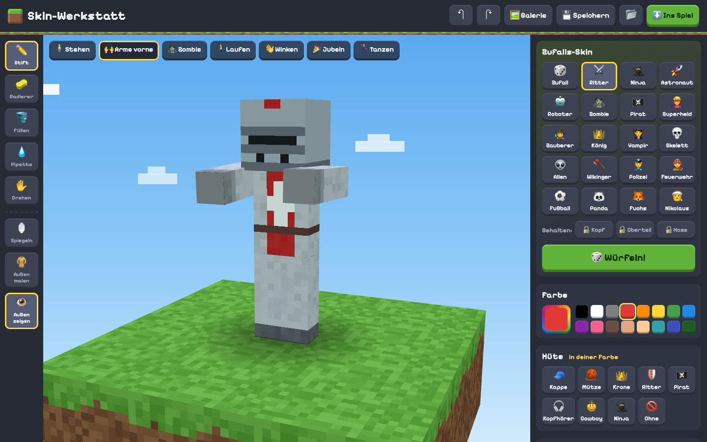
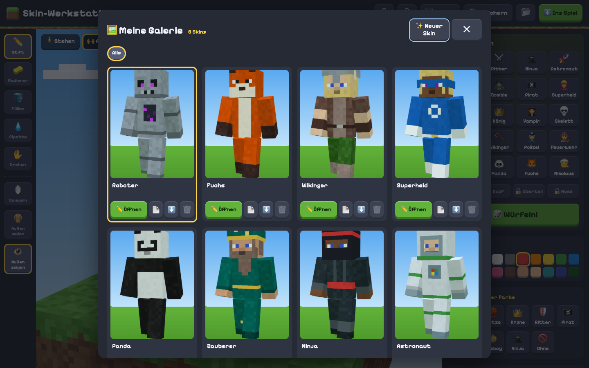
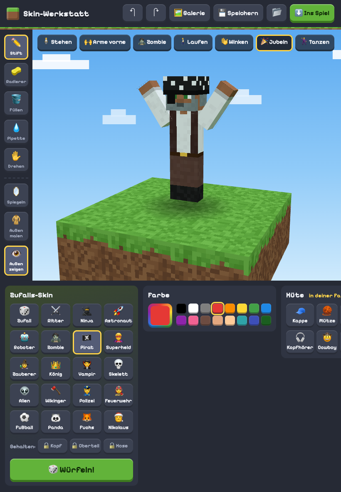
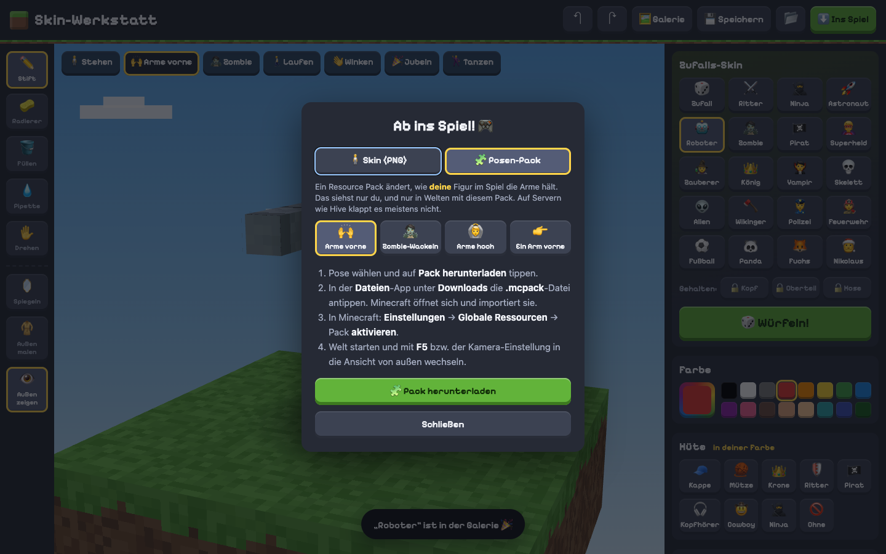

# ⛏️ Skin-Werkstatt

Ein Minecraft-Skin-Editor als Webseite, gemacht fürs iPad und Minecraft **Bedrock Edition**
(funktioniert damit auch auf Servern wie **The Hive**).

Skins selbst malen oder per Würfel erzeugen, in 3D mit Posen anschauen und als PNG ins Spiel holen.

**▶️ Ausprobieren: https://raoulus.github.io/skin-werkstatt/**



| Galerie                                                          | iPad hochkant                                                             |
| ---------------------------------------------------------------- | ------------------------------------------------------------------------- |
|  |  |



## Funktionen

- **3D-Ansicht** auf einer Grasblock-Plattform, mit Posen: Stehen, **Arme vorne**, Zombie, Laufen,
  Winken, Jubeln, Tanzen
- **Direkt auf die Figur malen**: Stift, Radierer, Füllen (bleibt innerhalb einer Fläche), Pipette,
  Spiegeln (links und rechts gleichzeitig), Rückgängig/Wiederholen
- **Zwei Schichten**: Grundschicht und äußere Schicht für Jacke und Hut
- **Zufalls-Skins** mit 20 Themen: Zufall, Ritter, Ninja, Astronaut, Roboter, Zombie, Pirat, Superheld,
  Zauberer, König, Vampir, Skelett, Alien, Wikinger, Polizei, Feuerwehr, Fußball, Panda, Fuchs, Nikolaus.
  Kopf, Oberteil oder Hose lassen sich beim Würfeln festhalten.
- **Hüte** auf Knopfdruck in der gewählten Farbe: Kappe, Mütze, Krone, Ritterhelm, Piratentuch,
  Kopfhörer, Cowboyhut, Ninja-Maske
- **Bastelbogen**: die flache 64×64-Textur mit Beschriftung, für Profis
- **Steve oder Alex**: breite (4 px) oder schmale (3 px) Arme
- **Import** vorhandener Skins (auch altes 64×32-Format) und **Export** als PNG
- **Posen-Pack (.mcpack)**: Resource Pack, damit die eigene Figur im Spiel z. B. die Arme vorne hält
  (Arme vorne, Zombie-Wackeln, Arme hoch, Ein Arm vorne)
- **Galerie** auf dem Gerät: Skins mit Namen und Schlagwörtern speichern, mit 3D-Vorschau
  durchstöbern, öffnen, als Vorlage kopieren, herunterladen, löschen
- Der aktuelle Skin bleibt auch nach dem Neuladen erhalten

## Skin ins Spiel holen (iPad, Bedrock)

1. In der Skin-Werkstatt auf **Ins Spiel** → **In Fotos sichern** tippen. Im Heimnetz (ohne HTTPS)
   stattdessen lange auf das Vorschaubild drücken → **Zu Fotos hinzufügen**.
2. Minecraft öffnen → **Umkleide** → **Klassische Skins**.
3. Bei **Eigene** auf das leere Feld → **Neuen Skin wählen** → Bild aus Fotos auswählen.
4. Das passende Modell wählen (breit = Steve, schmal = Alex).

## Posen-Pack ins Spiel holen

1. **Ins Spiel** → Reiter **Posen-Pack** → Pose wählen → **Pack herunterladen**.
2. In der **Dateien**-App unter **Downloads** die `.mcpack`-Datei antippen. Minecraft importiert sie.
3. Minecraft → **Einstellungen** → **Globale Ressourcen** → Pack aktivieren.

Die Pose sieht nur man selbst, und nur dort, wo das Pack aktiv ist. Server wie Hive verwenden eigene
Packs, dort wirkt es voraussichtlich nicht. Technisch überschreibt das Pack die Vanilla-Animation
`animation.player.move.arms` (siehe `src/resourcePack.ts`).

> **Hinweis zu Posen und Hüten:** Ein Skin ist nur ein Bild. Die Pose (z. B. „Arme vorne“) gibt es
> mit dem Skin allein nur in der Vorschau; im Spiel braucht es dafür das Posen-Pack. Hüte müssen in den Würfel
> um den Kopf passen. Etwas, das weit absteht, geht mit normalen Skins nicht.

## Entwicklung

Voraussetzung: Node.js 20 oder neuer.

```bash
npm install
npm run dev       # Dev-Server, im WLAN auch vom iPad erreichbar (Adresse wird angezeigt)
npm run build     # Typprüfung + statische Seite in dist/
npm run preview   # gebaute Seite lokal ansehen
```

Das Ergebnis in `dist/` ist eine rein statische Seite mit relativen Pfaden, ganz ohne Server.
Bei jedem Push auf `main` prüft und baut der Workflow `.github/workflows/deploy.yml` die Seite und
veröffentlicht sie auf **GitHub Pages**.

## Aufbau

| Datei                 | Inhalt                                                                   |
| --------------------- | ------------------------------------------------------------------------ |
| `src/main.ts`         | 3D-Szene, Malen per Touch/Maus, Bedienelemente, Import/Export, Speichern |
| `src/skinLayout.ts`   | Wo welcher Körperteil in der 64×64-Textur liegt, Spiegel-Logik           |
| `src/skinCanvas.ts`   | Die Textur selbst: Pixel setzen, Füllen, Rückgängig, Laden               |
| `src/playerModel.ts`  | Die Figur aus Quadern mit Gelenken, Treffer → Texturpixel                |
| `src/poses.ts`        | Posen und Animationen                                                    |
| `src/randomSkin.ts`   | Zufallsgenerator mit Themen und Festhalten                               |
| `src/hats.ts`         | Hüte auf der Kopf-Außenschicht                                           |
| `src/defaultSkin.ts`  | Eigener Start-Skin                                                       |
| `src/world.ts`        | Grasblock-Plattform                                                      |
| `src/gallery.ts`      | Galerie und Speichern-Dialog                                             |
| `src/db.ts`           | Lokale Galerie in IndexedDB                                              |
| `src/studio.ts`       | Unsichtbarer Renderer für die Vorschaubilder                             |
| `src/ui.ts`           | Kleine DOM-Helfer, Meldungen                                             |
| `src/resourcePack.ts` | Posen-Pack als .mcpack (Bedrock-Resource-Pack)                           |

Technik: [Vite](https://vite.dev), TypeScript, [Three.js](https://threejs.org), [fflate](https://github.com/101arrowz/fflate) für ZIP. Kein Backend.

Der Gesamtplan und der aktuelle Stand stehen in [`docs/PLAN.md`](docs/PLAN.md).

## Entstehung mit Claude Code

Die App wurde am 25.10.2026 in rund 80 Minuten (15:04–16:25 Uhr) zusammen mit
[Claude Code](https://claude.com/claude-code) gebaut, Modell Claude Opus 5.5. Die Zahlen stammen aus den
lokalen Sitzungsprotokollen. Doppelt gespeicherte Antworten aus fortgesetzten Sitzungen sind nur einmal gezählt.

| Kennzahl                                    |                         Wert |
| ------------------------------------------- | ---------------------------: |
| Antworten von Claude                        |                          105 |
| Tool-Aufrufe (Dateien schreiben, Befehle …) |                          109 |
| Ausgabe-Tokens (von Claude geschrieben)     |                      173.416 |
| Neue Eingabe-Tokens                         |                          210 |
| Eingabe-Tokens in den Cache geschrieben     |                      315.743 |
| Eingabe-Tokens aus dem Cache gelesen        |                   16.721.109 |
| **Tokens insgesamt**                        |              **≈ 17,2 Mio.** |
| Quellcode (TypeScript, CSS, HTML)           | ≈ 3.900 Zeilen in 14 Modulen |

Der Großteil der Tokens sind Cache-Lesezugriffe: Bei jedem Schritt liest das Modell den bisherigen
Gesprächsverlauf erneut, das meiste davon kommt günstig aus dem Cache. Stand der Zahlen: vor dem
Hinzufügen dieses Abschnitts.
